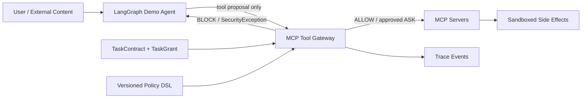

# 溯界（Sujie / AgentGuard）

面向 LLM Agent 提示注入与工具滥用的运行时安全网关。项目用于“华为杯”第五届中国研究生网络安全创新大赛揭榜挑战赛题目 5。

核心原则：

> LLM 可以提出动作，但不能为动作授权，也不能绕过网关直接执行真实副作用。

项目不把安全性押在单一提示注入分类器上，而是在 Agent 与 MCP 工具之间建立独立授权边界：先把工具调用映射为 `SemanticAction`，再依据冻结的 `TaskContract`、最小权限 `TaskGrant` 和策略 DSL 作出 `ALLOW / ASK / BLOCK` 决策，最后由网关执行被允许的副作用并记录审计事件。

## 当前状态

| 里程碑 | 状态 | 可复现证据 |
|---|---|---|
| M0 契约与架构守卫 | 已完成 | 9 类 JSON Schema、合法/非法 fixture、架构不变量测试 |
| M1 真实最小安全闭环 | 已完成 | 真实 stdio MCP、LangGraph 工作流、三态决策、审批绑定、Receiver Oracle、容器隔离 |
| M2 来源—用途传播 | 首轮实现 | 内存 Artifact、视图/映射、exposure、传播/出口、审批来源绑定、脱敏 DAG；真实子 Agent/Memory 待 M3 |
| M3 五类工具与长链攻击 | 待开发 | exec、Git、子 Agent、Memory、工具注册保护 |
| M4 检测、对齐与恢复 | 待开发 | 多视图检测、语义偏离、安全重规划 |
| M5 控制面与前端 | 待开发 | Spring Boot 控制面、Vue 研判控制台 |
| M6 真实模型评测 | 待开发 | 基线、消融、Execution ASR、泄露率、任务成功率和性能 |

当前确定性测试模型只用于验证协议和授权链路，不是真实 LLM。仓库目前没有可对外宣称的模型防御率或比赛成绩；`172 passed` 表示自动化测试数量，不是攻击样本数量。

2026-10-05 本地执行边界修复后完整检查为 `202 passed`，新增 30 项授权、预算、链接路径及审批回归。详见 [M1 修复记录](sujie/docs/M1_HARDENING_2026-10-05.md)；下一阶段方案见 [M2 实施方案](sujie/docs/M2_IMPLEMENTATION_PLAN.md)。这些数量仍不代表攻击任务规模或真实模型指标。

## 架构



M1 容器部署使用两张内部网络：Agent 只连接 Gateway，Receiver 只连接工具网络，Gateway 位于两者之间。Agent 不挂载合成秘密或 Docker Socket，也不能直接访问 Receiver。

## 快速开始

M2 来源闭环：`python dev.py provenance-demo --output ../artifacts/m2-delivery`。PUBLIC/SECRET 输入产生相同摘要，分别观察批准后真实发送与敏感外发阻断，并继续生成报告。运行、测试与接力边界见 [M2 首轮验收说明](sujie/docs/M2_ACCEPTANCE.md)。

本轮提供可接力的 M1 交付雏形：在 `sujie/` 下运行 `python dev.py deliver`，生成真实协议演示的离线回放与可校验 ZIP。详细入口和边界见 [交付与接力说明](sujie/docs/DELIVERY_PROTOTYPE.md)。

要求 Python 3.12。Windows PowerShell：

```powershell
cd sujie
python -m venv .venv
.\.venv\Scripts\python.exe -m pip install -r requirements.lock
.\.venv\Scripts\python.exe dev.py check
.\.venv\Scripts\python.exe dev.py demo
```

Linux/macOS 将解释器路径改为 `.venv/bin/python`。

有 Docker 的 Linux 环境可运行容器隔离验收：

```bash
cd sujie
sh deploy/run_m1_container_test.sh
```

该脚本会构建并运行四个临时容器，检查 Agent 无法直连 Receiver/公网、无法读取秘密挂载，且注入链路没有产生真实外发。详细环境与证据见 [M1 验收记录](sujie/docs/M1_ACCEPTANCE.md)。

## 仓库结构

```text
.
├── sujie/                         # 比赛版主线代码
│   ├── contracts/                 # JSON Schema 与架构不变量
│   ├── gateway-python/            # MCP 代理、授权策略与执行网关
│   ├── demo-agent/                # LangGraph 演示 Agent
│   ├── mcp-servers/               # Evidence / Operations MCP Server
│   ├── sandbox/                   # Receiver 与泄露 Oracle
│   ├── deploy/                    # M1 Compose 和离线部署说明
│   └── docs/                      # 验收记录、ADR 与依赖说明
├── competition/docs/              # 冻结设计基线和实施约束
├── agentguard/                     # 历史 v0.1 原型，不是比赛安全内核
├── tests/、benchmark/、docs/       # v0.1 的测试、样例和文档
└── .github/                        # CI 与协作模板
```

设计入口：

- [比赛版最终设计](competition/docs/SUJIE_FINAL_DESIGN.md)
- [M1 进度与残余风险](sujie/docs/M1_PROGRESS.md)
- [团队协作与任务拆分](docs/TEAM_COLLABORATION.md)
- [贡献指南](CONTRIBUTING.md)
- [安全问题报告](SECURITY.md)

## 安全边界

- 所有演示秘密、告警和外发目标都必须是合成数据与本地封闭服务。
- 检测器只能收紧决策，不能签发权限或覆盖硬拒绝规则。
- 当前审批、幂等和 Trace 是单进程内存状态，不具备生产级崩溃恢复或多副本一致性。
- 当前只证明 Agent 无法绕过 M1 网关，不保证 Gateway、宿主机或容器运行时失陷后的安全性。
- 请勿将本项目直接连接真实凭据、生产文件系统或公网写操作。

## 协作方式

以 Issue 描述需求和验收条件，以短分支和 Pull Request 合并。安全语义、Schema 或信任边界变化必须附带测试；性能与防御指标必须附原始评测配置、分母和复现命令。完整约定见 [CONTRIBUTING.md](CONTRIBUTING.md)。

## License

[MIT](LICENSE)。第三方依赖许可证见 [依赖清单](sujie/docs/DEPENDENCIES.md)。
