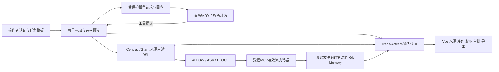

# 当前架构导航

更新：2026-10-15。此页描述 `sujie/` 比赛主线；根目录 `agentguard/` 的v0.1设计见[历史设计](../AgentGuard%20v0.1%20开发设计文档.md)。代码映射与运行约束见[交接手册](../sujie/docs/PROJECT_HANDOFF.md)。

ASK批准不产生副作用，提交时重新核验才执行。模型、子Agent和检测器均不能签发权限。Host侧业务Oracle独立核对实际读取、报告事实及效果，不只检查模型最终答复。

LangGraph确定性演示与当前有界百炼Host并存；当前不是所有任务都通过旧测试图。子/孙对话在同一Host，M20分析角色无工具但不是OS沙箱。旧M1双网络容器仅证明旧链路，新版整体隔离/全入口绑定待完成。
