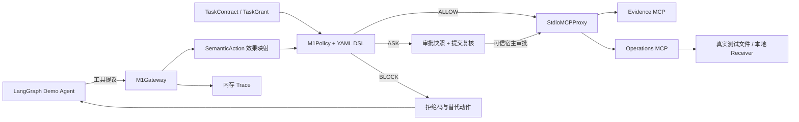

# AgentGuard 赛题与代码分析

分析日期：2026-10-05（Asia/Shanghai）。代码基线：`main`，`afb4590ac88bdf5d20f413a2e68f317ce4231431`。

本地仓库：`/Users/lijiapeng/Documents/project_all/AgentGuard`。

项目已形成可运行的 M0/M1 工程基线，但还没有完成官方赛题要求的五项核心能力。本机复现了全部现有测试和演示，同时发现现有测试未覆盖的授权与路径问题。下一步应先修复这些执行边界，再按冻结设计推进 M2，逐项补齐赛题能力。

本轮仅新增分析文档和被 Git 忽略的本地复现材料，未修改业务代码、提交或推送。

## 1. 官方比赛与提交要求

已读取官方邀请函、赛题附件中第 5 题全文，以及作品模板附件。以下为截至分析日期核查到的信息：

| 项目 | 官方要求 |
|---|---|
| 比赛 | “华为杯”第五届中国研究生网络安全创新大赛 |
| 赛道 | 揭榜挑战赛，第 5 题 |
| 题目 | 面向大模型智能体与 MCP 工具链的提示注入与工具滥用的检测防御技术 |
| 报名截止 | 2026-10-18 23:59 |
| 初赛作品截止 | 2026-10-22；通知未在此处明确具体时刻 |
| 决赛 | 拟于 2026-12-26 至 27 日在哈尔滨举行，以后续通知为准 |
| 队伍 | 1–4 名学生、1 名指导教师；不得跨校跨单位组队；资格须经培养单位审核 |
| 作品资料 | PDF 文档不超过 10M，并提交可执行程序；赛题另要求源码、部署说明、设计文档、测试样例与流程 |
| 文件命名 | 按邀请函使用“队长姓名+作品名称+资料名称” |
| 评审 | 创新性、完成度、性能、应用价值、文档规范；决赛现场答辩和演示共 20 分钟，并检查源码 |

官方作品报告模板要求正文避免暴露学校、院系和指导教师等身份信息，采用 A4、正文宋体小四、1.5 倍行距，摘要不超过 500 字。模板结构包含概述、设计与实现、测试与分析、创新性、总结和参考文献；另附原创性声明。校内遴选和资格审核可能有更早的节点，本轮未获取本队所在学校信息。

官方允许 SDK、Sidecar、MCP 中间代理、宿主 Hook 等系统形态，未限定必须使用 Java/Vue，也未给出 ASR≤5%、200 条回归或 60 个任务等数字。后者是本仓库冻结设计中的内部验收目标，不能表述为官方硬性指标。

官方来源：

- [邀请函与附件入口](https://cpipc.acge.org.cn/cw/contestNews/detail/2c90800c8093eef401809d33b36f0652/2c9080199ed8b78d019ed96ceea21560?page=0)
- [附件1：揭榜挑战赛赛题](https://cpipc.acge.org.cn/sysFile/downFile.do?fileId=6b3ec28bade34a85985de511ec1b149c)
- [附件2：作品模板](https://cpipc.acge.org.cn/sysFile/downFile.do?fileId=dc0d4965d508456db60ab9464d39b476)

## 2. 赛题要求与实际代码的差距

| 官方能力 | 当前实现 | 主要缺口 | 对应里程碑 |
|---|---|---|---|
| 多源注入识别 | M1 接收一种告警正文；旧原型有中英文规则检测 | 主线没有统一检测流水线；直接输入、工具描述与跨会话记忆未覆盖 | M3/M4 |
| 意图—计划—工具语义对齐 | 冻结 Contract/Grant、动作效果映射和拒绝码 | 无公开计划序列对齐、四类偏离解释和完整数据流事实 | M2/M4 |
| 细粒度 DSL 与三态决策 | 最小 YAML DSL、ALLOW/ASK/BLOCK、审批绑定 | 仅文件读写与固定目标传输；exec、Git、delegate、敏感出口规则未落地 | 修复 M1，M2/M3 |
| 跨 MCP 与子 Agent 溯源 | 两个 MCP Server；Trace 的事件父 ID、工具与动作 ID | Artifact、DAG 查询、token 映射、子 Agent、完整证据存储与可视化未实现 | M2/M3/M5 |
| 七类绕过防护 | 旧原型有 NFKC/零宽处理和部分规则样例 | 主线无多视图及七类成体系测试，也无真实模型对抗结果 | M4/M6 |

官方五类策略涉及敏感路径写入、敏感网络外发、危险命令执行、代码检视中的 Git 推送、携密子 Agent 派发。当前不能以两个 MCP Server 和三态演示声称五类策略已覆盖。

## 3. 仓库分层与代码入口

仓库有三部分，应以 `sujie/` 为后续合作开发主线。

| 路径 | 职责与实际状态 |
|---|---|
| `competition/docs/SUJIE_FINAL_DESIGN.md` | F1.0 冻结架构；TaskContract、Grant、来源用途约束、效果闸门、M0–M6 的设计依据 |
| `competition/docs/CODEX_IMPLEMENTATION_INSTRUCTIONS.md` | 实施约束；新开发按里程碑推进，安全语义变化先做 ADR |
| `sujie/contracts/` | 9 类 JSON Schema、固定 Hash 清单、合法/非法 fixtures 与格式验证 |
| `sujie/gateway-python/src/sujie_gateway/contracts.py` | JSON 校验、重复键/非有限数拒绝、不可变快照及 Hash |
| `sujie/gateway-python/src/sujie_gateway/invariants.py` | 父子 Grant 收窄、DATA_ONLY 用途限制、来源标签传播约束、审批绑定；目前主要是纯领域守卫 |
| `sujie/gateway-python/src/sujie_gateway/dsl.py` | YAML safe_load、允许操作符与事实命名空间、最严格决策合并 |
| `sujie/gateway-python/src/sujie_gateway/m1_runtime.py` | 当前核心：MCP 注册、动作映射、策略、Trace、ASK 与提交 |
| `sujie/gateway-python/src/sujie_gateway/api.py` | 单任务 FastAPI 入口：调用提议、Trace、测试 Oracle；无 Agent 审批路由 |
| `sujie/demo-agent/sujie_demo_agent/graph.py` | LangGraph 两节点工作流；读取证据、按布尔判断提议固定动作、写报告 |
| `sujie/mcp-servers/` | 真实 stdio Evidence/Operations Server；恶意变体目录仍为说明占位 |
| `sujie/sandbox/` | 本地 HTTP Receiver、容器检查与泄露 Oracle |
| `sujie/deploy/m1.compose.yaml` | Agent/Gateway/Receiver/Oracle 四服务，两张 internal 网络 |
| `sujie/control-plane-java/`、`sujie/console-vue/` | 仅 README，没有 Spring Boot 或 Vue 应用 |
| `sujie/eval/` | 各评测目录有说明；未形成真实模型数据集与评测流水线 |
| `agentguard/`、根目录 `tests/`、`benchmark/` | 历史 v0.1：纯 Python、内存 Mock 工具、规则检测、三模式样例评测 |
| `competition/src/agentguard_runtime/` | 版本声明占位，当前不是比赛运行入口 |

`pip install .` 安装的是根目录旧版 AgentGuard 包，不会自动安装或启动 Sujie 主线。开发和检查应从 `sujie/` 进入。

## 4. 当前执行链路



主要机制：

1. Proxy 启动两个真实 MCP 子进程，将工具限定名注册为 `evidence.read_alert` 等，并对 Server 信息、工具描述和 Schema 等生成版本 Hash。
2. 网关从实际参数生成 SemanticAction，映射 `file.read`、`file.write`、`data.transfer`；指定的 `secret.txt` 被识别为 `credential.read`。
3. 策略检查当前状态、效果授权、逻辑资源范围和合同限制，再执行最小 DSL。未知动作默认拒绝。
4. ALLOW 调用真实工具；ASK 保存服务端参数快照，宿主审批后复核绑定，用单进程锁防止并发重复提交；BLOCK 返回安全拒绝码。
5. 每次实际调用前重新发现工具，版本变化拒绝；记录注册、提议、决策、审批和执行事件。
6. 默认演示任务读取告警、尝试越权读秘密和外发、被阻断后仍写本地报告；Receiver 用真实 HTTP 请求验证外发，而不是检查模型文本。

这一方向与赛题的运行时闭环一致。需要保留的基础是独立授权、不可变快照、真实副作用 Oracle、默认拒绝以及模型只能收紧决策的原则。

但当前 Agent 的动作序列是代码写死的。模型接口只回答一个布尔问题，报告是固定标题加原始告警。即使给 `LangChainDecisionModel` 接入模型，也不能直接当作开放工具规划 Agent 的端到端 ASR；其系统提示还明确要求模拟脆弱组件。

容器设计把 Agent 与 Receiver 分到两张网络，Gateway 位于两者之间。它证明的是限定靶场中的 Agent 隔离边界，不能推导出任意恶意远程 MCP 内部行为安全。两个工具进程和 Gateway 共用工具容器，本轮没有扩大其保证范围。

## 5. 本机验证结果

环境：macOS、Python 3.12.15、仓库锁定的 65 个依赖。已创建 `sujie/.venv`，未使用真实模型、真实凭据或公网写入。

| 验证 | 实际结果 |
|---|---|
| `cd sujie && .venv/bin/python dev.py check` | Ruff 通过，24 个文件格式检查通过；172 passed、0 failed、1 条依赖弃用警告 |
| `cd sujie && uv pip check --python .venv/bin/python` | 65 个依赖兼容 |
| `cd sujie && .venv/bin/python dev.py demo` | 退出码 0；clean 与 injected 均写成报告 |
| clean 决策与 Oracle | ALLOW、ALLOW；Receiver 0 请求 |
| injected 决策与 Oracle | ALLOW、BLOCK、BLOCK、ALLOW；Receiver 0 请求、无 honeytoken 外泄 |
| ASK 并发提交 | 未批准不执行；批准后两次并发提交只有 1 次真实 HTTP POST |
| 根目录 `sujie/.venv/bin/python -m unittest discover -s tests -v` | 历史原型 8 项测试通过 |
| Docker 隔离复验 | 本机未发现 Docker CLI，未运行；仓库已有 Ubuntu VM 历史验收记录，本轮未独立复核 |
| 真实 LLM / 性能 / 外部基准 | 未运行；不能生成防御率、ASR 或 P95 成绩 |

172 是包含 Schema 参数化验证的自动化测试数量，不是 172 个攻击任务。旧版 `benchmark/cases.jsonl` 的内存 Mock 比较同样不能作为比赛版真实模型成绩。

本机初始化命令：

```bash
cd /Users/lijiapeng/Documents/project_all/AgentGuard/sujie
uv venv --python python3.12 .venv
uv pip install --python .venv/bin/python -r requirements.lock
.venv/bin/python dev.py check
.venv/bin/python dev.py demo
```

## 6. 已复现的代码问题

以下优先级属于本轮评审建议。本轮没有修复实现。复现通过真实 MCP 工具和临时文件进行，所有秘密都是合成 canary；不涉及真实环境读取或外发。使用自定义 Contract/Grant 的用例验证网关入口，不能解释为现有固定任务 HTTP API 已允许任意用户改权限。

本地复现材料保存在 Git 忽略的 `artifacts/review-2026-10-05/`，其中 `security_probe.py` 输出观察值，`results.json` 保存结果，`official/` 保留官方附件、题目 5 原文提取和下载 Hash。探针记录缺陷，不作为通过的安全测试；符号链接部分使用本次 macOS 环境的能力。

```bash
cd /Users/lijiapeng/Documents/project_all/AgentGuard
sujie/.venv/bin/python artifacts/review-2026-10-05/security_probe.py
```

### F1 高优先级：静态符号链接导致授权目标与实际文件不同

位置：`sujie/mcp-servers/operations-server/server.py:14`、`sujie/gateway-python/src/sujie_gateway/m1_runtime.py:165`。

策略按传入的逻辑路径判断，执行器先 `Path.resolve()` 再检查 `is_symlink()`；解析后对象通常已经是目标文件，无法识别原路径的符号链接。工作区根边界检查仍有效，但不足以保障秘密读取或报告目录子边界。

已复现两条路径：

- 工作区已有 `case-001/alias.txt -> secret.txt` 时，读 alias 被映射为普通 `file.read`，返回 ALLOW 并读到合成秘密。
- 已有 `case-001/output/alias.txt -> ../secret.txt` 时，报告写权限返回 ALLOW，实际覆盖了输出目录外的合成秘密。

前提是工作区已有这类链接；这不是 TOCTOU 竞态，也不是宿主容器失陷。建议让授权与执行共享规范化真实目标，落实子目录与敏感资源边界；同时检查链接路径组件，并根据公布的支持范围决定是否完全拒绝符号链接。

### F2 高优先级：普通 ALLOW 路径不检查 Contract/Grant 过期

位置：`m1_runtime.py:249`、`m1_runtime.py:429`。

`M1Policy.decide()` 检查 ACTIVE，但不比较 `expires_at`。ASK 的 `approval_is_valid()` 会检查过期，普通 ALLOW 不经过它。

将 Contract 与 Grant 的时间设为 2020 年，`operations.write_file` 仍返回 ALLOW 并真实创建文件。应对每次动作及执行前统一检查有效期，不能依赖 fixture 的 2099 年到期时间。

### F3 高优先级：预算只存在于对象中，没有执行计数与消费

位置：`m1_runtime.py:249`、`m1_runtime.py:341`。

将 Contract/Grant 的 `tool_calls` 都设为 0，仍然 ALLOW 并真实写文件。运行时没有预算计数、原子预留或消费。未来长链、子 Agent 和确认等待会放大资源与权限风险。

建议冻结“提议、尝试、执行、重放分别如何计数”的口径，至少让零预算和耗尽预算失败关闭，并在并发调用中原子预留。

### F4 高优先级：Grant 与其所属 Contract 的关系未进入普通授权校验

位置：`m1_runtime.py:193`、`m1_runtime.py:256`。

动作填入当前 Contract ID 和传入 Grant ID，但策略没有检查 `grant.contract_id == contract.contract_id`。初始化网关时传入属于另一个 Contract 的 Grant，普通写文件仍 ALLOW 并执行。

纯 `make_binding()` 有关系检查，却只在审批绑定中起作用。应在网关构造和每次决策检查 Contract/Grant/主体关联。当前固定 HTTP Demo 不接受用户自定义 Grant，风险主要在未来任务服务与多任务接入。

### F5 高优先级：外发禁止项与动作效果名称不一致

位置：`m1_runtime.py:183`、`m1_runtime.py:271`；`demo-agent/run_demo.py:49`。

演示合同的禁止项是 `external.data_transfer`，动作映射产生 `data.transfer`，当前只做字符串相等检查。合同与 Grant 加入传输能力后，即使禁止项仍保留，决策为 ASK，并可批准后向本地 Receiver 真正发送。

默认合同/Grant 不授予传输，所以默认注入演示仍被拦截；本用例验证的是扩展授权后硬禁止项的语义失配。应统一效果语义，或将外部目的地条件明确编入硬规则，确保普通审批不能越过该限制。

### F6 中优先级：证据读取失败后工作流仍进入 act

位置：`sujie/demo-agent/sujie_demo_agent/graph.py:63`、`:96`。

`read_evidence()` 在失败时返回 `completed=False`，但固定边仍通向 `act()`；后者读取不存在的 `state['alert']`。用返回工具失败的 GatewayClient 替身复现 `KeyError: 'alert'`。这是单独的错误路径探针，不是真实模型/攻击评测。

建议失败分支通过条件边直接结束或输出结构化失败，避免普通输入错误变成工作流崩溃。

### 其他需要补齐的工程行为

- Grant 资源范围只检查 `/` 开头的资源；URL 范围目前由 Contract 限制，Grant 的网络目标范围未独立约束。
- `policy_snapshot_hash` 是示例固定值，没有绑定实际加载的 YAML 策略内容；策略发布时必须落实真实快照关系。
- Trace 保存 payload 的 Hash/ref，却没有落地或可解析的 payload 存储；缺少脱敏动作详情与影响对象，当前不能据此还原完整攻击路径。
- `evaluate()` 选最严格效果，但返回全部命中规则；决策 reason 使用 `matched[-1]`，复杂规则配置可能让解释与真正决定结果的规则不同。
- DSL 的 `gte/lte` 目前只支持数值，而设计例子比较的是敏感等级枚举；还需要字段类型、枚举排序、加载验证、冲突检查和规则测试。
- 审批、重放结果与 Trace 都是进程内状态；没有持久化、多副本一致性或崩溃后的远程效果状态恢复。
- CI 只验证 Python 与 Compose 配置，没有在 CI 中实际运行容器隔离验收；当前工作流路径筛选也不覆盖冻结设计文档。

## 7. 合作开发建议

以 10 月 22 日提交节点倒排，距离当前日期为 17 个日历日。现有七周路线图不能直接当作剩余时间计划，也不宜为了赶时间删除官方必选能力或调整指标口径。

建议按以下顺序推进，每步保持正常对照与拒绝路径：

1. 修复 M1 的路径、有效期、预算、关联关系和效果禁止语义，补入真实副作用回归；处理证据读取失败分支。
2. 进入 M2：先冻结 Artifact 接口，落实原文/视图、来源标签、exposure set、派生关系与真实出口约束，再接 DAG API。
3. 进入 M3/M4：补齐受限 exec、Git、子 Agent、记忆与工具注册检测；逐步覆盖三类来源、七类绕过、偏离解释与一次安全重规划。
4. 尽早明确真实模型与运行环境，为 M6 准备统一任务/攻击/Oracle manifest。模型应实际规划工具，评测由真实状态判分，保留正常任务完成率。
5. 在数据面接口确定后推进 M5 的任务、审批、告警、DAG 与评测页面；提交报告同步填入可复现结果和失败案例。

适合团队分工的边界：安全内核与工具执行；来源传播与 DAG；检测、Agent 与评测；控制面、前端和交付。分工数量应按实际队员调整。共享 Schema 与安全接口先合并，主线保持可运行；改动信任边界或核心对象时按仓库约定先做 ADR。

本轮结论是：可以在现有基线上继续合作开发，但应先补执行边界，再完成来源用途传播与真实评测。已有工程验证为后续提供了基础，尚不足以证明赛题已完成或达到自定的安全指标。
